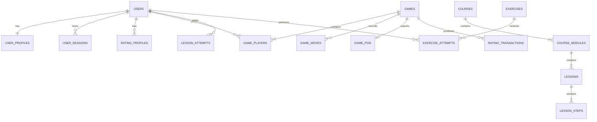

# ERD simplificado

## Particionamento futuro

- `game_moves`: por hash de `game_id` ou faixa de `committed_at`.
- `games`: por mês de `created_at` após volume elevado.
- `audit_logs`: por mês.
- `exercise_attempts`: por mês ou hash de usuário.
